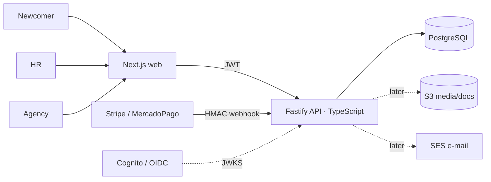

# Architecture

Monorepo: `apps/api` (Fastify, zod, pg, jose, Vitest) · `apps/web` (Next.js App Router) · `db/migrations` (plain SQL, tracked in `schema_migrations`).
Key rule: **the API is the only place that decides what a caller may see** (see `docs/api.md` → privacy invariants).
